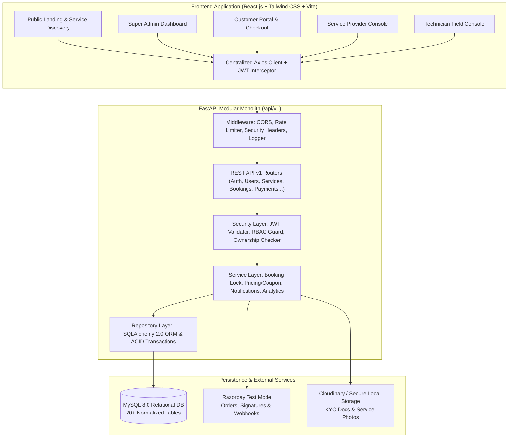
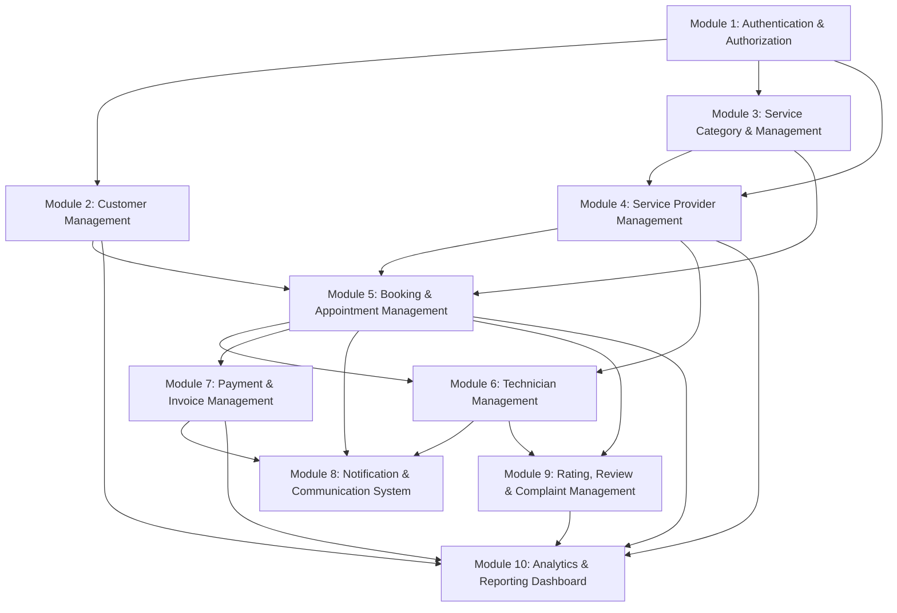
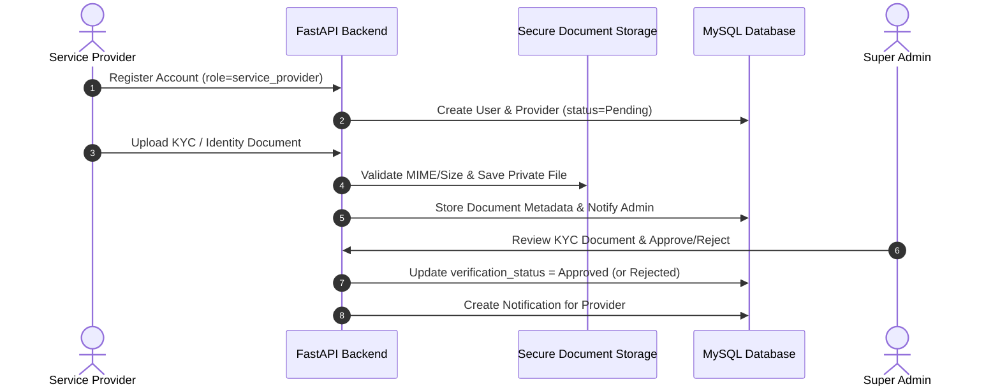
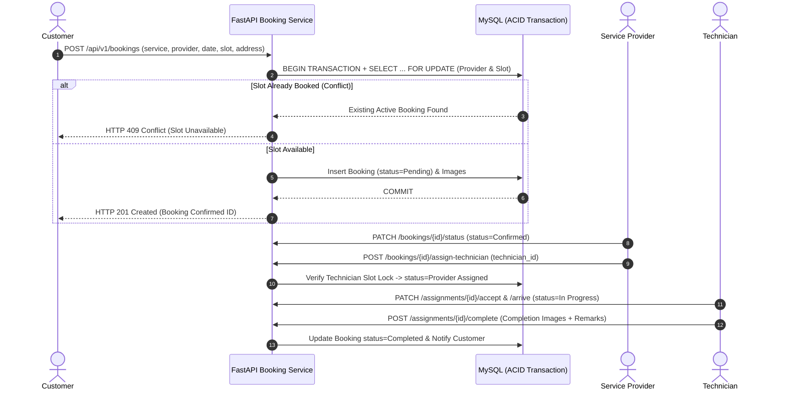
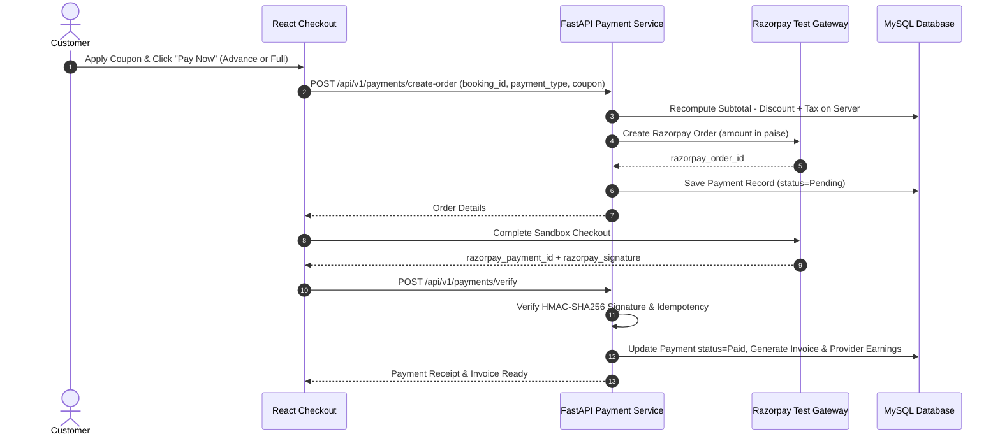

# 05 — System Architecture, Module Dependencies & Workflow Diagrams
## HomeServe Technologies — Home Services Booking SaaS Platform

---

## 1. High-Level System Architecture Diagram

---

## 2. Module Dependency Diagram (10 Functional Modules)

---

## 3. Overall Project Flow Diagram

```mermaid
flowchart LR
    A["1. Provider Onboarding & KYC Upload"] --> B["2. Super Admin Approves Provider & Catalog"]
    B --> C["3. Provider Configures Services, Areas & Slots"]
    C --> D["4. Customer Discovers Service & Checks Slot"]
    D --> E["5. Customer Submits Booking + Problem Images"]
    E --> F["6. Provider Accepts Booking & Assigns Technician"]
    F --> G["7. Technician Accepts, Arrives & Completes Job"]
    G --> H["8. Customer Pays via Razorpay -> Invoice Issued"]
    H --> I["9. Customer Submits Review -> Analytics Updated"]
```

---

## 4. Business Workflow & State-Machine Diagrams

### 4.1 Service Provider Verification Workflow

### 4.2 End-to-End Booking & Double-Booking Prevention Workflow

### 4.3 Payment, Commission & Invoice Workflow (Razorpay Test Mode)

