# Phase 3 — Database Design, ER Diagram & Normalization Specification
## HomeServe Technologies — Home Services Booking SaaS Platform

---

## 1. Entity-Relationship (ER) Diagram

```mermaid
erDiagram
    USERS ||--o| CUSTOMERS : "1:1 role=customer"
    USERS ||--o| SERVICE_PROVIDERS : "1:1 role=service_provider"
    USERS ||--o| TECHNICIANS : "1:1 role=technician"
    USERS ||--o{ NOTIFICATIONS : "1:N receives"
    USERS ||--o{ REFRESH_TOKENS : "1:N session revocation"

    SUBSCRIPTION_PLANS ||--o{ SERVICE_PROVIDERS : "1:N governs commission"

    CUSTOMERS ||--o{ ADDRESSES : "1:N saved locations"
    CUSTOMERS ||--o{ BOOKINGS : "1:N places"
    CUSTOMERS ||--o{ PAYMENTS : "1:N pays"
    CUSTOMERS ||--o{ INVOICES : "1:N billed to"
    CUSTOMERS ||--o{ REVIEWS : "1:N writes"
    CUSTOMERS ||--o{ COMPLAINTS : "1:N raises"
    CUSTOMERS ||--o{ CUSTOMER_FAVORITES : "1:N bookmarks"

    SERVICE_CATEGORIES ||--o{ SERVICE_CATEGORIES : "1:N parent_id subcategories"
    SERVICE_CATEGORIES ||--o{ SERVICES : "1:N categorizes"

    SERVICES ||--o{ PROVIDER_SERVICES : "1:N offered via"
    SERVICES ||--o{ BOOKINGS : "1:N booked for"

    SERVICE_PROVIDERS ||--o{ PROVIDER_SERVICES : "1:N custom catalog"
    SERVICE_PROVIDERS ||--o{ SERVICE_AREAS : "1:N geographic coverage"
    SERVICE_PROVIDERS ||--o{ AVAILABILITY_SLOTS : "1:N working windows"
    SERVICE_PROVIDERS ||--o{ TECHNICIANS : "1:N employs"
    SERVICE_PROVIDERS ||--o{ BOOKINGS : "1:N fulfills"
    SERVICE_PROVIDERS ||--o{ PROVIDER_EARNINGS : "1:N earns"
    SERVICE_PROVIDERS ||--o{ REVIEWS : "1:N rated in"
    SERVICE_PROVIDERS ||--o{ COMPLAINTS : "1:N disputed in"
    SERVICE_PROVIDERS ||--o{ CUSTOMER_FAVORITES : "1:N favorited"

    ADDRESSES ||--o{ BOOKINGS : "1:N service location"
    COUPONS ||--o{ BOOKINGS : "1:N applied discount"

    BOOKINGS ||--o| BOOKING_ASSIGNMENTS : "1:1 technician dispatch"
    BOOKINGS ||--o{ BOOKING_IMAGES : "1:N problem/before/after/completion"
    BOOKINGS ||--o{ PAYMENTS : "1:N advance/full/balance"
    BOOKINGS ||--o| INVOICES : "1:1 tax invoice"
    BOOKINGS ||--o| REVIEWS : "1:1 verified review"
    BOOKINGS ||--o{ COMPLAINTS : "1:N dispute tickets"
    BOOKINGS ||--o| PROVIDER_EARNINGS : "1:1 settlement ledger"

    TECHNICIANS ||--o{ BOOKING_ASSIGNMENTS : "1:N assigned field jobs"
```

---

## 2. Complete Inventory of the 20 Core Normalized Tables (+ 3 Technical Support Tables)

### Core 20 Entities Mandated by `Vibe_Coding_Capstone_Home_Services_SaaS.docx`

| # | Table Name | Primary Key | Foreign Keys | Unique Constraints & Key Indexes |
| :---: | :--- | :--- | :--- | :--- |
| **1** | `users` | `id` | — | `UQ(email)`, `UQ(phone)`, `IDX(role, is_active)` |
| **2** | `customers` | `id` | `user_id -> users.id` | `UQ(user_id)` |
| **3** | `service_providers` | `id` | `user_id -> users.id`, `subscription_plan_id -> subscription_plans.id` | `UQ(user_id)`, `IDX(verification_status, average_rating)` |
| **4** | `technicians` | `id` | `user_id -> users.id`, `provider_id -> service_providers.id` | `UQ(user_id)`, `IDX(provider_id, is_available)` |
| **5** | `addresses` | `id` | `customer_id -> customers.id` | `IDX(customer_id, is_default)`, `IDX(postal_code)` |
| **6** | `service_categories` | `id` | `parent_id -> service_categories.id` (nullable) | `UQ(slug)`, `IDX(parent_id, is_active)` |
| **7** | `services` | `id` | `category_id -> service_categories.id` | `IDX(category_id, is_active)`, `IDX(base_price)` |
| **8** | `provider_services` | `id` | `provider_id -> service_providers.id`, `service_id -> services.id` | `UQ(provider_id, service_id)` |
| **9** | `service_areas` | `id` | `provider_id -> service_providers.id` | `UQ(provider_id, postal_code)`, `IDX(city, postal_code)` |
| **10** | `availability_slots` | `id` | `provider_id -> service_providers.id` | `UQ(provider_id, day_of_week, start_time, end_time)` |
| **11** | `bookings` | `id` | `customer_id`, `provider_id`, `service_id`, `address_id`, `coupon_id` | `UQ(booking_number)`, `IDX(provider_id, scheduled_date, start_time, status)`, `IDX(customer_id, created_at)` |
| **12** | `booking_assignments` | `id` | `booking_id -> bookings.id`, `technician_id -> technicians.id`, `assigned_by -> users.id` | `UQ(booking_id)`, `IDX(technician_id, status)` |
| **13** | `booking_images` | `id` | `booking_id -> bookings.id`, `uploaded_by -> users.id` | `IDX(booking_id, image_type)` |
| **14** | `payments` | `id` | `booking_id -> bookings.id`, `customer_id -> customers.id` | `UQ(idempotency_key)`, `IDX(booking_id, status)`, `IDX(razorpay_order_id)` |
| **15** | `invoices` | `id` | `booking_id -> bookings.id`, `customer_id -> customers.id`, `provider_id -> service_providers.id` | `UQ(invoice_number)`, `UQ(booking_id)` |
| **16** | `coupons` | `id` | — | `UQ(code)`, `IDX(is_active, valid_until)` |
| **17** | `reviews` | `id` | `booking_id -> bookings.id`, `customer_id -> customers.id`, `provider_id -> service_providers.id` | `UQ(booking_id)` *(1 review per completed booking)*, `IDX(provider_id, is_visible)` |
| **18** | `complaints` | `id` | `booking_id -> bookings.id`, `customer_id -> customers.id`, `provider_id -> service_providers.id`, `resolved_by -> users.id` | `UQ(complaint_number)`, `IDX(status, created_at)` |
| **19** | `notifications` | `id` | `user_id -> users.id` | `IDX(user_id, is_read, created_at)` |
| **20** | `provider_earnings` | `id` | `provider_id -> service_providers.id`, `booking_id -> bookings.id`, `payment_id -> payments.id` | `UQ(booking_id)`, `IDX(provider_id, settlement_status)` |

### Technical Support Tables (Justified per Section 5.3)
- **21. `subscription_plans`** — Supports Super Admin *"Manage platform subscription plans"* (`Standard`, `Pro`, `Enterprise`) and defines deterministic commission percentages (`DECIMAL(5,2)`).
- **22. `customer_favorites`** — Normalized `M:N` join table (`customer_id`, `provider_id`) supporting Customer *"Manage favorite service providers"* with `UQ(customer_id, provider_id)`.
- **23. `refresh_tokens`** — Supports Section 8.1 *"Token revocation or secure logout strategy"* and password reset invalidation.

---

## 3. Normalization Justification (1NF, 2NF, 3NF)

1. **First Normal Form (1NF):** All attributes are atomic. Multi-valued attributes such as customer addresses (`addresses`), provider covered pincodes (`service_areas`), offered services (`provider_services`), and booking photos (`booking_images`) are extracted into dedicated child tables rather than comma-separated strings.
2. **Second Normal Form (2NF):** Every non-key attribute in join tables (`provider_services`, `customer_favorites`, `booking_assignments`) depends on the whole candidate key.
3. **Third Normal Form (3NF) & Controlled Snapshot Integrity:** Transitive dependencies are eliminated across master entities. In financial/audit tables (`bookings`, `invoices`, `provider_earnings`), historical monetary snapshots (`subtotal`, `discount_amount`, `tax_amount`, `total_amount`, `commission_percentage`) are intentionally captured at transaction time using `DECIMAL(10,2)` so future catalog price edits never corrupt historical invoices or accounting ledgers.

---

## 4. Data Ownership, Referential Integrity & Retention Rules

- **Soft Deactivation over Destructive Cascading:** Master accounts (`users`, `customers`, `service_providers`, `services`) use `is_active` flags and `ON DELETE RESTRICT` on `bookings`, `payments`, `invoices`, and `provider_earnings` so financial records are immutable and never orphaned.
- **Double-Booking Concurrency Control:** Composite index `idx_booking_slot_lock (provider_id, scheduled_date, start_time, status)` combined with `SELECT ... FOR UPDATE` row locking in the booking transaction prevents concurrent double-booking.
- **Backup & Recovery Strategy:** Daily automated MySQL logical dumps (`mysqldump --single-transaction --routines --triggers`) + point-in-time binary log recovery (`binlog_format=ROW`) with 30-day encrypted snapshot retention.

